# LAPORAN PRAKTIKUM PBO - A

NAMA        : Theofani Natanya Anari Hutabarat

NPM         : 4525210074

MATA KULIAH : Pemograman Berbasis Objek

KELAS       : A

MATERI      : Pertemuan09

DOSEN       : Adi Wahyu Pribadi, S.Si., M.Kom

## Java
a. Anggota.java

Screenshot = 

- After :
  
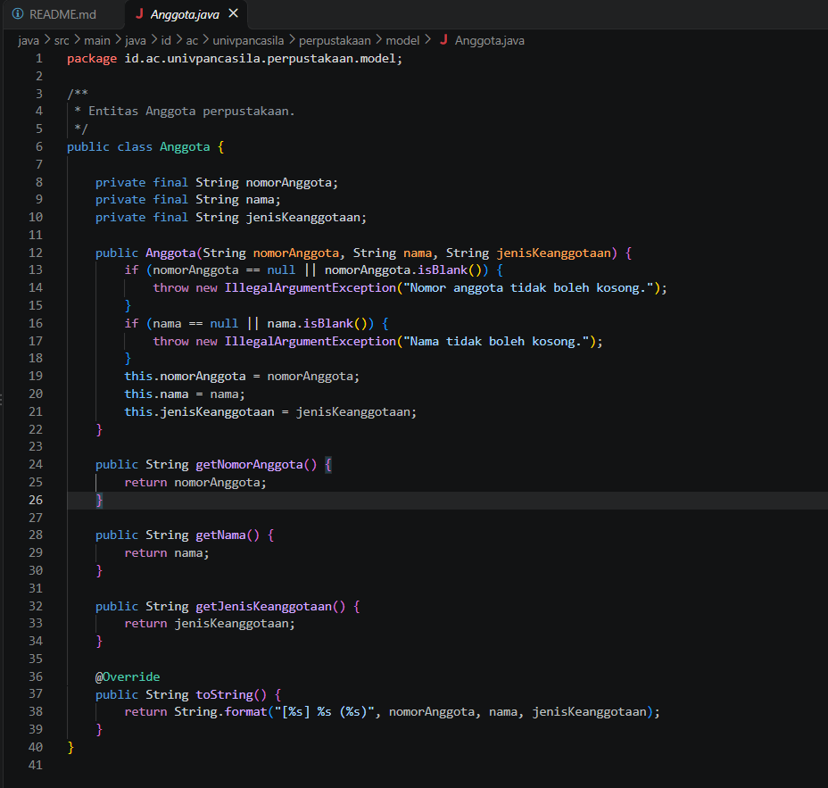

Melanjutkan pembuatan class Anggota.java sebagai entitas anggota perpustakaan yang memiliki atribut nomor anggota, nama, dan jenis keanggotaan. Class ini sudah dilengkapi constructor, validasi data agar nomor anggota dan nama tidak kosong, getter untuk mengambil nilai atribut, serta method toString() untuk menampilkan informasi anggota.

b. Buku.java

Screenshot = 

- After :
  
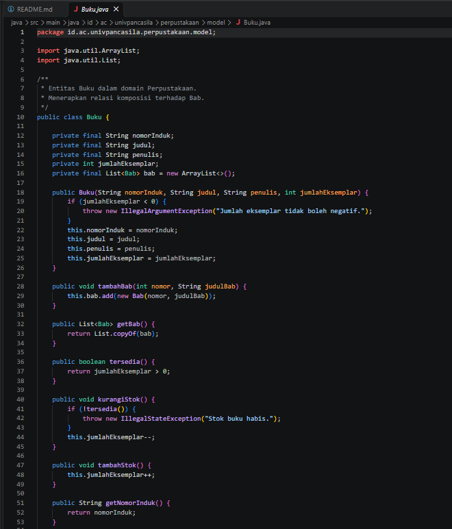
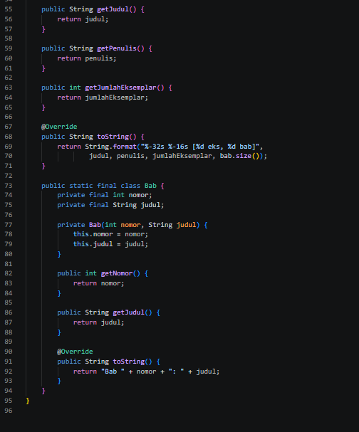

Melanjutkan pembuatan class Buku.java sebagai entitas buku dalam sistem perpustakaan. Class ini memiliki atribut nomor induk, judul, penulis, dan jumlah eksemplar. Selain itu, terdapat fitur untuk menambahkan bab, melihat daftar bab, mengecek ketersediaan buku, serta menambah dan mengurangi stok buku. Class ini juga menerapkan konsep komposisi melalui class Bab.

c. Peminjaman.java

Screenshot = 

- After :
  
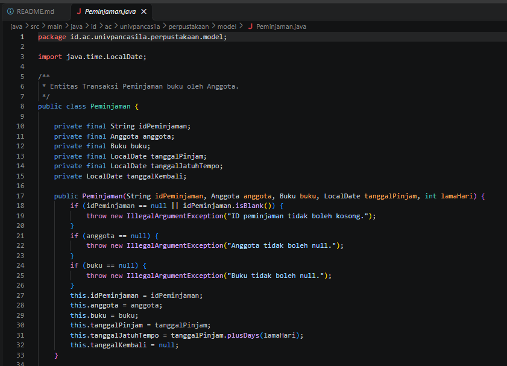
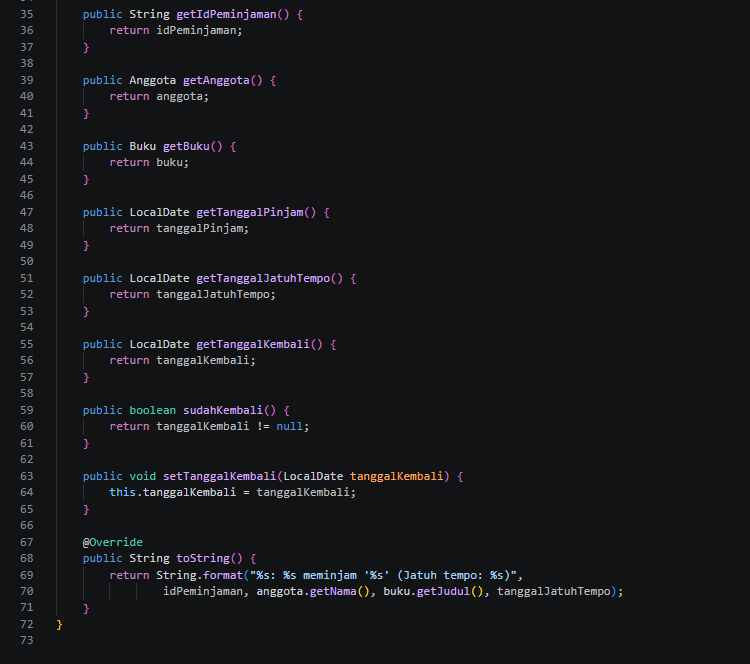

Melanjutkan pembuatan class Peminjaman.java sebagai entitas transaksi peminjaman buku oleh anggota perpustakaan. Class ini memiliki atribut ID peminjaman, data anggota, data buku, tanggal pinjam, tanggal jatuh tempo, dan tanggal kembali. Selain itu, terdapat validasi data, getter untuk mengambil informasi peminjaman, serta method untuk mengecek status pengembalian buku. Class ini menerapkan konsep relasi antarobjek (asosiasi) antara Anggota dan Buku dalam proses peminjaman.

d. PerpustakaanService.java

Screenshot = 

- After :
  
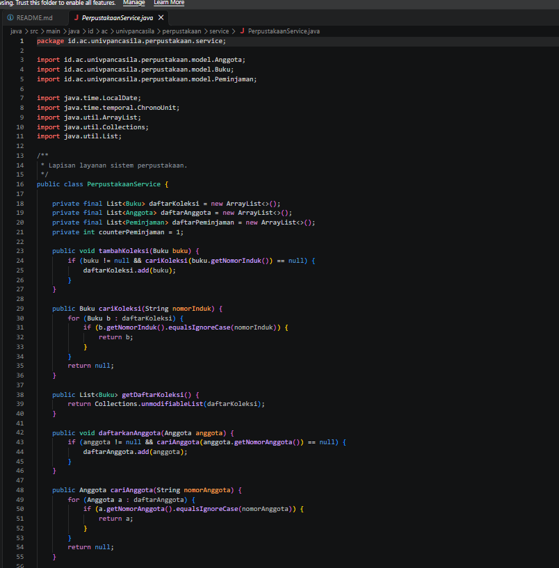
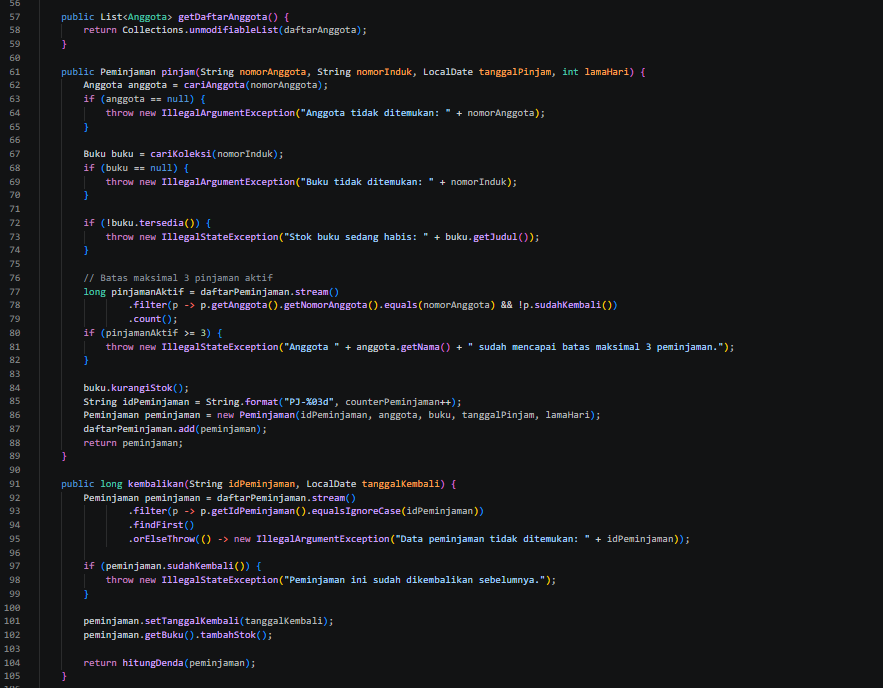

Melanjutkan pembuatan class PerpustakaanService.java sebagai layanan utama untuk mengelola sistem perpustakaan. Class ini memiliki fitur untuk menambahkan dan mencari koleksi buku, mendaftarkan anggota, mengelola transaksi peminjaman dan pengembalian buku, serta menghitung denda keterlambatan. Selain itu, terdapat aturan maksimal 3 peminjaman aktif untuk setiap anggota dan perbedaan tarif denda berdasarkan jenis keanggotaan. Class ini berfungsi menghubungkan entitas Anggota, Buku, dan Peminjaman agar proses pengelolaan perpustakaan berjalan dengan baik.

e. Format.java

Screenshot = 

- After :
  
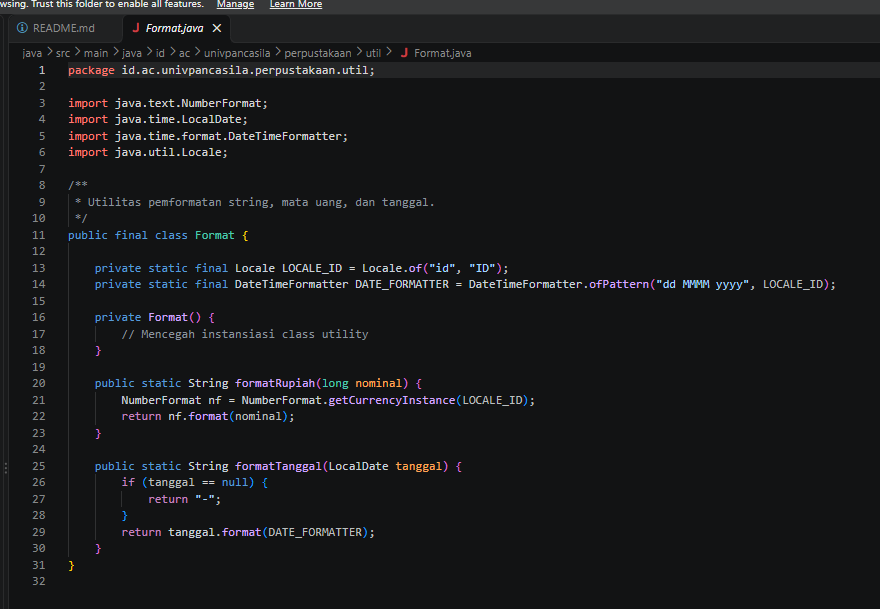

Melanjutkan pembuatan class Format.java sebagai class utilitas untuk membantu pemformatan data dalam sistem perpustakaan. Class ini menyediakan method untuk mengubah nominal menjadi format mata uang Rupiah (IDR) dan mengubah tanggal menjadi format Indonesia (tanggal, bulan, dan tahun). Class ini menggunakan konsep static method sehingga fitur pemformatan dapat digunakan tanpa perlu membuat objek baru.

f. App.java :

Screenshot = 

- After :
  
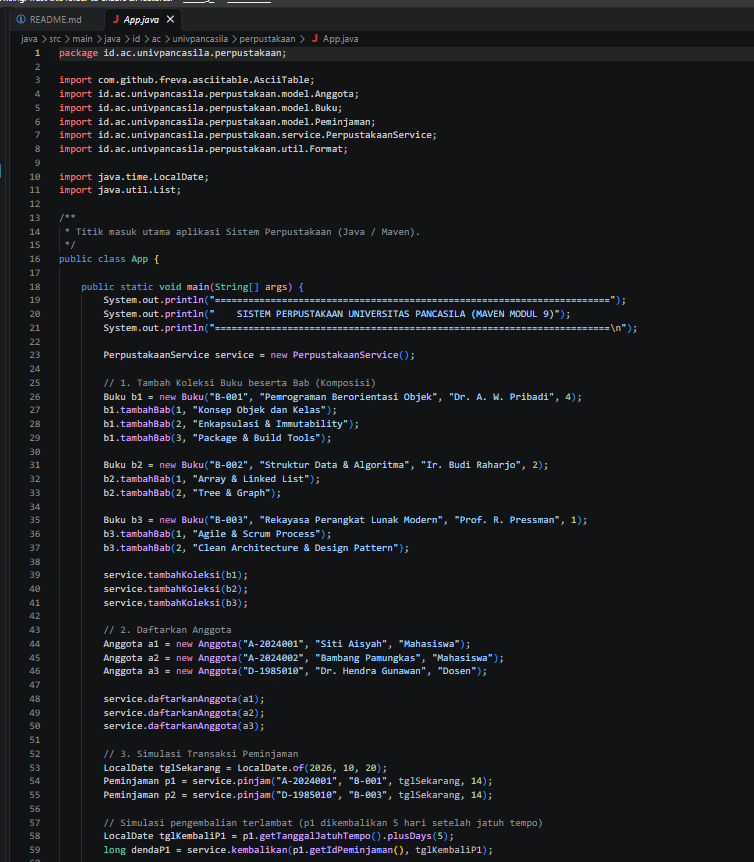
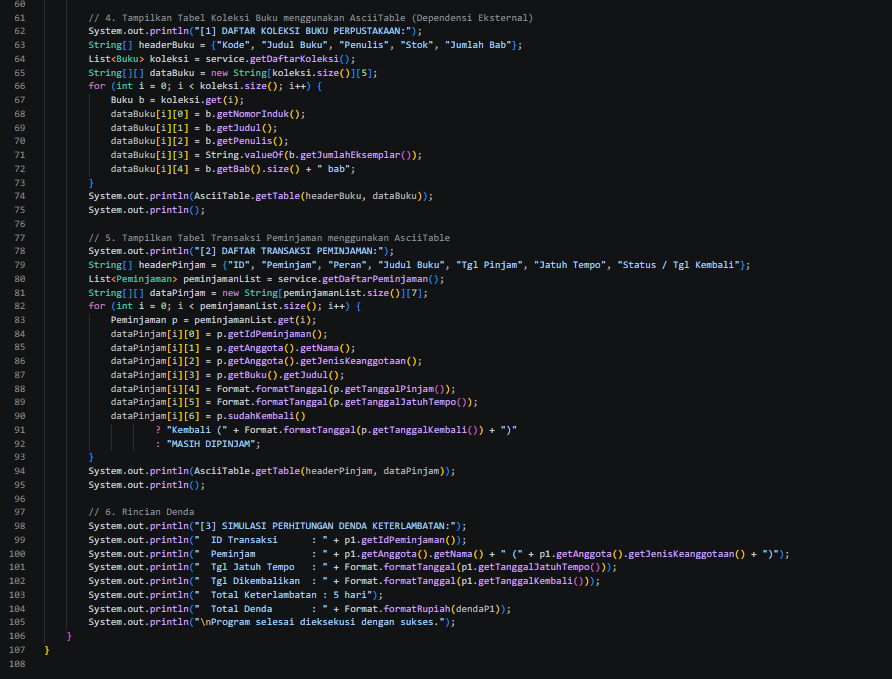

Melanjutkan pembuatan class App.java sebagai class utama untuk menjalankan dan menguji Sistem Perpustakaan Universitas Pancasila. Class ini menggabungkan seluruh fitur yang telah dibuat sebelumnya, mulai dari penambahan koleksi buku beserta bab, pendaftaran anggota, simulasi peminjaman dan pengembalian buku, hingga perhitungan denda keterlambatan. Selain itu, class ini menggunakan library eksternal AsciiTable untuk menampilkan data koleksi buku dan transaksi peminjaman dalam bentuk tabel agar lebih rapi dan mudah dibaca. Class App.java menjadi titik masuk utama program melalui method main().

## PHP
a. Anggota.php

Bukti Screenshot =

- After :
  
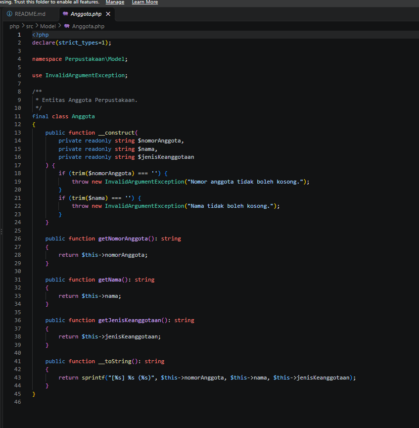

Melanjutkan pembuatan class Anggota.php sebagai entitas anggota perpustakaan menggunakan bahasa PHP. Class ini memiliki atribut nomor anggota, nama, dan jenis keanggotaan. Selain itu, terdapat validasi untuk memastikan nomor anggota dan nama tidak boleh kosong. Class ini menggunakan konsep OOP PHP, yaitu constructor, access modifier private, readonly, getter, serta method __toString() untuk menampilkan informasi anggota.

b. Bab.php

Bukti Screenshot = 

- After :
  
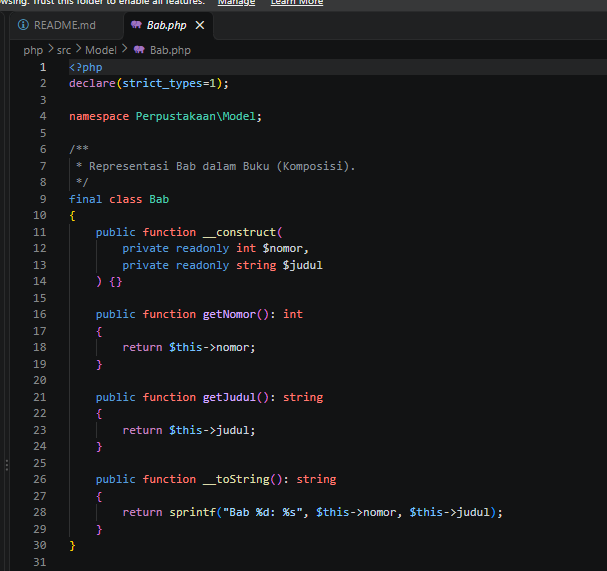

Melanjutkan pembuatan class Bab.php sebagai representasi bab yang terdapat di dalam sebuah buku. Class ini memiliki atribut nomor bab dan judul bab yang bersifat private readonly, sehingga nilainya tidak dapat diubah setelah objek dibuat. Selain itu, terdapat getter untuk mengambil nomor dan judul bab serta method __toString() untuk menampilkan informasi bab. Class ini menerapkan konsep komposisi (composition), yaitu bab menjadi bagian dari buku.

c. Buku.php

Bukti Screenshot = 

- After :
  
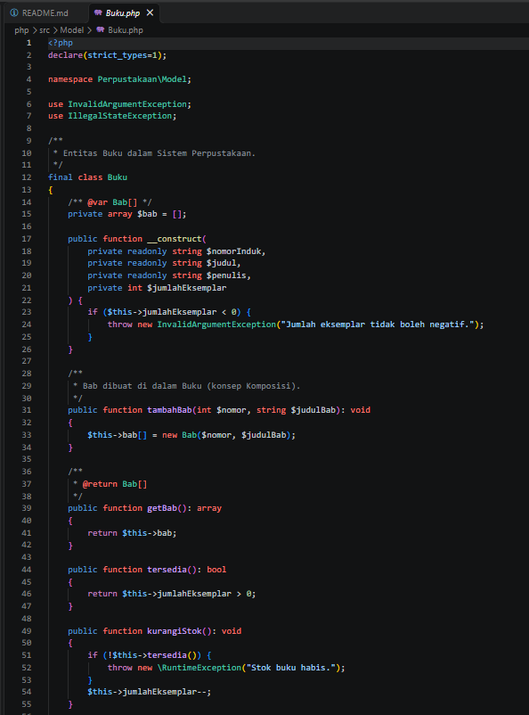
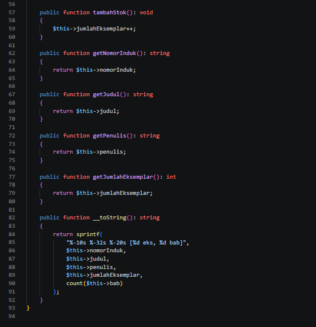

Melanjutkan pembuatan class Buku.php sebagai entitas buku dalam sistem perpustakaan menggunakan PHP. Class ini memiliki atribut nomor induk, judul, penulis, dan jumlah eksemplar. Selain itu, terdapat fitur untuk menambahkan bab, melihat daftar bab, mengecek ketersediaan buku, serta menambah dan mengurangi stok buku. Class ini menerapkan konsep komposisi (composition) melalui class Bab, serta menggunakan validasi untuk mencegah jumlah stok bernilai negatif.

d. Peminjaman.php

Bukti Screenshot = 

- After :

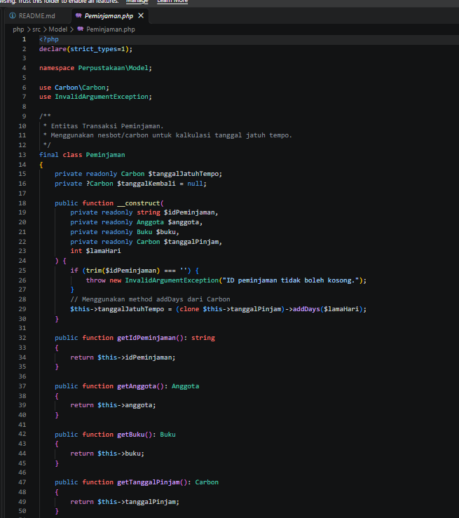
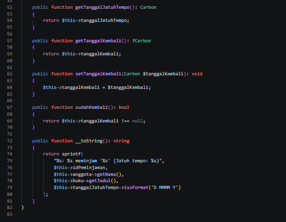

Melanjutkan pembuatan class Peminjaman.php sebagai entitas transaksi peminjaman buku oleh anggota perpustakaan menggunakan PHP. Class ini memiliki atribut ID peminjaman, data anggota, data buku, tanggal pinjam, tanggal jatuh tempo, dan tanggal kembali. Class ini menggunakan library Carbon untuk menghitung tanggal jatuh tempo berdasarkan lama hari peminjaman. Selain itu, terdapat getter untuk mengambil data transaksi serta method untuk mengatur tanggal pengembalian dan mengecek status pengembalian buku. Class ini menerapkan konsep relasi antarobjek (asosiasi) antara Anggota dan Buku.

e. PerpustakaanService.php

Bukti Screenshot = 

- After :
  

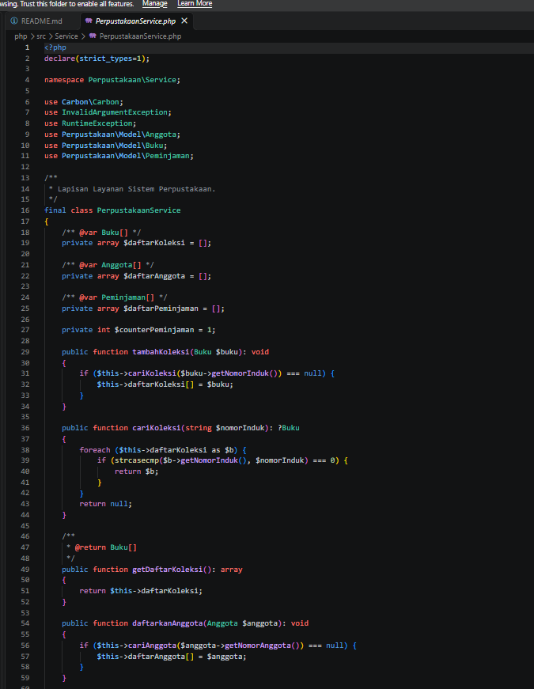
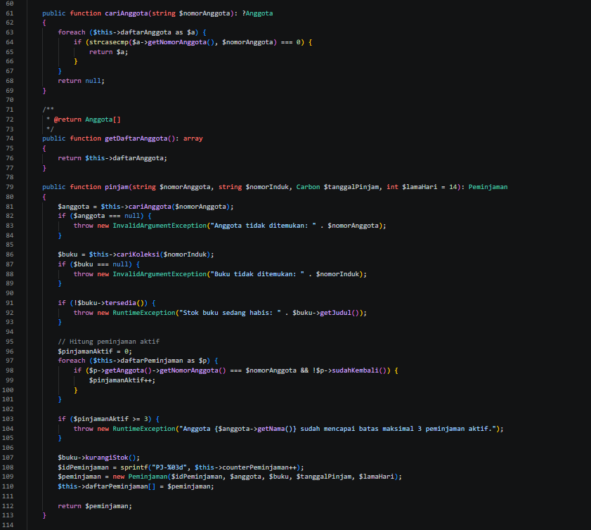

Melanjutkan pembuatan class PerpustakaanService.php sebagai layanan utama untuk mengelola sistem perpustakaan menggunakan PHP. Class ini memiliki fitur untuk menambahkan dan mencari koleksi buku, mendaftarkan anggota, mengelola transaksi peminjaman dan pengembalian buku, serta menghitung denda keterlambatan. Selain itu, class ini menerapkan aturan maksimal 3 peminjaman aktif untuk setiap anggota dan perbedaan tarif denda berdasarkan jenis keanggotaan, yaitu mahasiswa, dosen, dan anggota kehormatan. Class ini berfungsi menghubungkan class Anggota, Buku, dan Peminjaman agar seluruh proses pengelolaan perpustakaan dapat berjalan dengan teratur.

f. Format.php

Bukti Screenshot = 

- After :
  
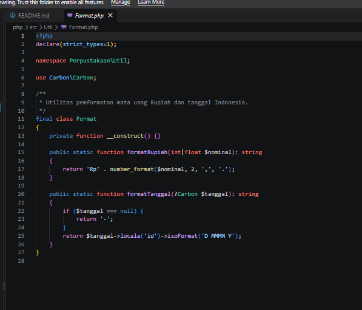

Melanjutkan pembuatan class Format.php sebagai class utilitas untuk membantu pemformatan data dalam sistem perpustakaan menggunakan PHP. Class ini menyediakan method untuk mengubah nominal denda ke dalam format mata uang Rupiah (Rp) dan mengubah tanggal menjadi format Indonesia (tanggal, bulan, dan tahun). Class ini menggunakan static method sehingga fitur pemformatan dapat digunakan tanpa harus membuat objek baru. Selain itu, library Carbon digunakan untuk membantu pemformatan tanggal.

g. main.php

Bukti Screenshot = 

- After :
  
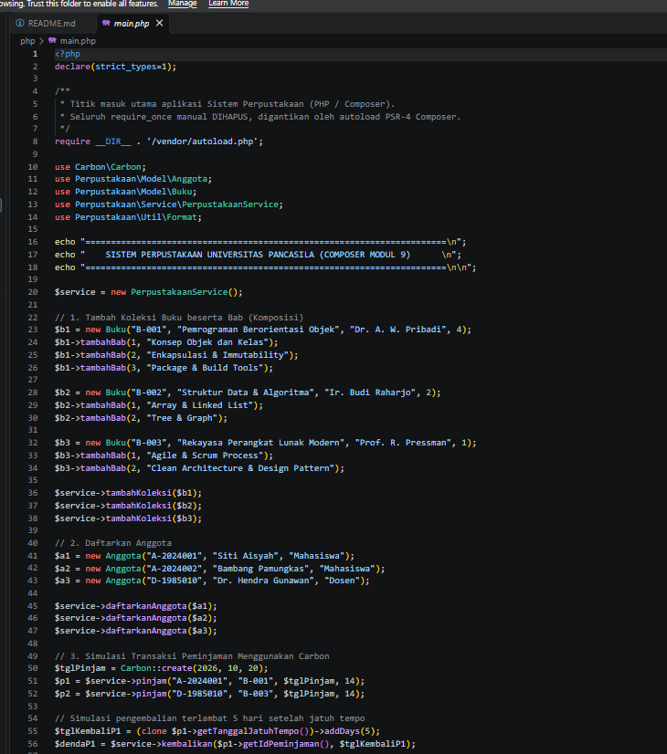
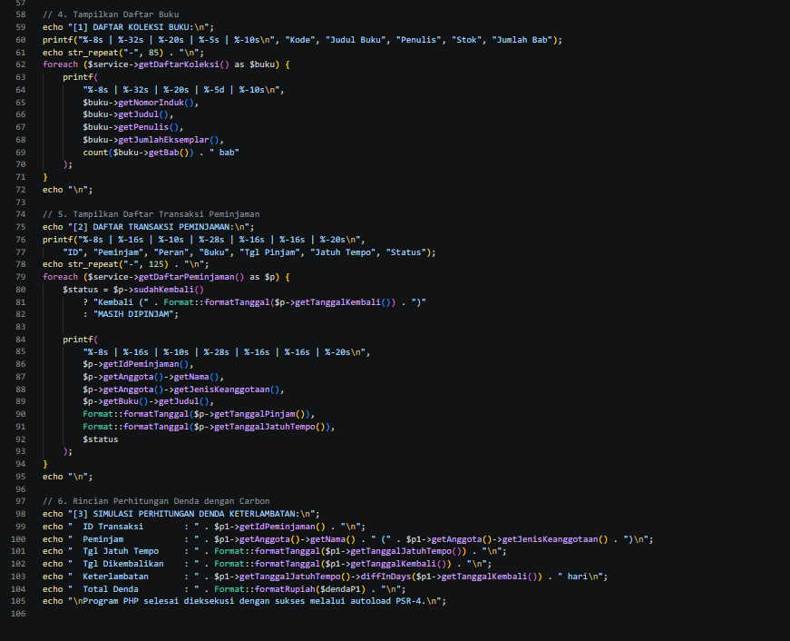

Melanjutkan pembuatan file Main.php sebagai program utama untuk menjalankan Sistem Perpustakaan menggunakan PHP dan Composer. File ini menggabungkan seluruh class yang telah dibuat, mulai dari pengelolaan buku dan anggota, transaksi peminjaman dan pengembalian, hingga perhitungan denda keterlambatan.

File ini menggunakan Composer Autoload PSR-4 untuk memanggil class secara otomatis dan library Carbon untuk pengelolaan tanggal.