# LAPORAN PRAKTIKUM PBO - A

NAMA        : Theofani Natanya Anari Hutabarat

NPM         : 4525210074

MATA KULIAH : Pemograman Berbasis Objek

KELAS       : A

MATERI      : Pertemuan07

DOSEN       : Adi Wahyu Pribadi, S.Si., M.Kom

## Java
a. Buku.java

Screenshot = 

- Before :
  
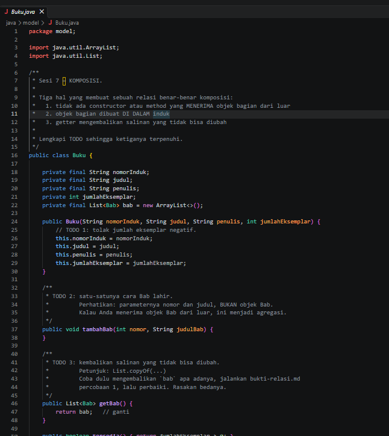
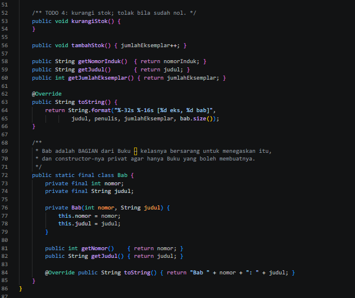

TODO 1: Belum ada validasi untuk menolak jumlah eksemplar yang negatif.

TODO 2: Method tambahBab() belum memiliki perintah untuk membuat dan menambahkan objek Bab ke dalam daftar buku.

TODO 3: Method getBab() masih mengembalikan daftar bab secara langsung sehingga daftar tersebut bisa dimodifikasi dari luar.

TODO 4: Method kurangiStok() belum memiliki logika untuk mengurangi stok buku dan menolak pengurangan jika stok sudah nol.

- After :
  
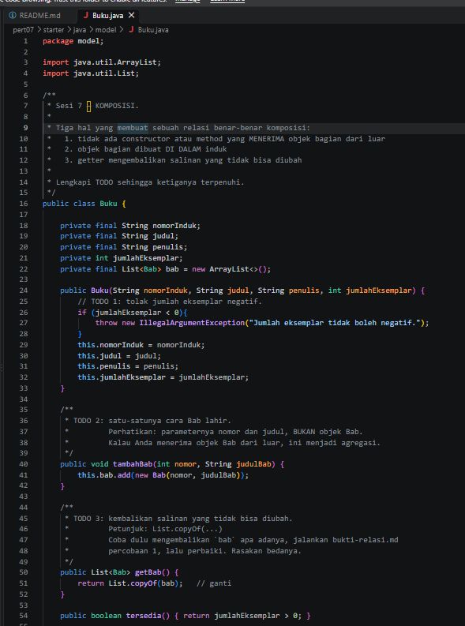
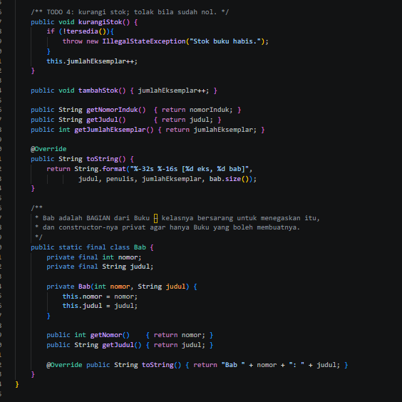

TODO 1: Menambahkan validasi if (jumlahEksemplar < 0) dan IllegalArgumentException agar jumlah eksemplar tidak boleh negatif.

TODO 2: Menambahkan this.bab.add(new Bab(nomor, judulBab)) agar objek Bab dibuat langsung di dalam kelas Buku dan ditambahkan ke daftar bab.

TODO 3: Menggunakan List.copyOf(bab) agar getter mengembalikan salinan daftar bab yang tidak bisa dimodifikasi.

TODO 4: Menambahkan pengecekan tersedia() untuk menolak pengurangan ketika stok habis.

b. Jurusan.java

Screenshot = 

- Before :
  
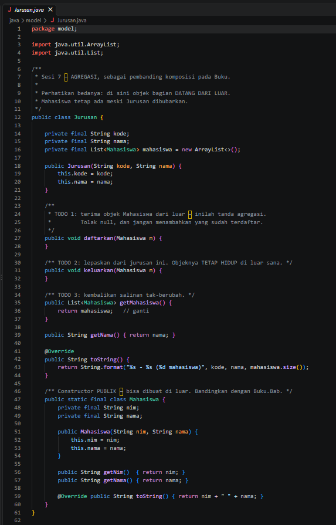

TODO 1: Method daftarkan() belum memiliki logika untuk menambahkan mahasiswa, menolak nilai null, dan mencegah mahasiswa yang sama terdaftar lebih dari sekali.

TODO 2: Method keluarkan() belum memiliki perintah untuk mengeluarkan mahasiswa dari daftar jurusan tanpa menghapus objek mahasiswa tersebut.

TODO 3: Method getMahasiswa() masih mengembalikan daftar mahasiswa secara langsung sehingga daftar dapat dimodifikasi dari luar.

- After :
  
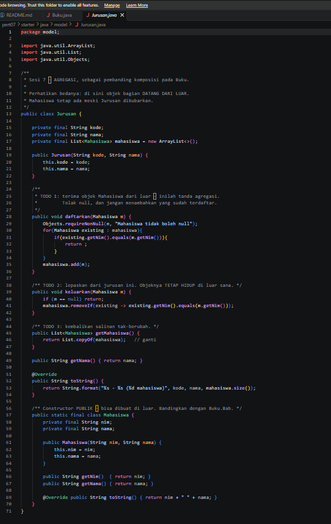

TODO 1: Menambahkan Objects.requireNonNull() untuk menolak mahasiswa bernilai null, melakukan pengecekan NIM agar mahasiswa tidak terdaftar dua kali, dan menambahkan mahasiswa jika belum terdaftar.

TODO 2: Menambahkan pengecekan null dan removeIf() untuk mengeluarkan mahasiswa berdasarkan NIM dari daftar jurusan. Objek mahasiswa tetap bisa digunakan di luar jurusan.

TODO 3: Menggunakan List.copyOf(mahasiswa) agar getter mengembalikan salinan daftar yang tidak bisa dimodifikasi dari luar.

c. PerpustakaanService.java

Screenshot = 

- Before :
  
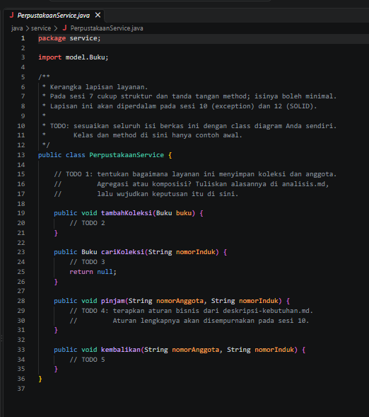
TODO 1: Belum ada atribut untuk menyimpan koleksi buku dan belum ditentukan bagaimana layanan mengelola koleksi tersebut.

TODO 2: Method tambahKoleksi() belum memiliki perintah untuk menambahkan buku ke dalam koleksi perpustakaan.

TODO 3: Method cariKoleksi() belum memiliki logika untuk mencari buku berdasarkan nomor induk.

TODO 4: Method pinjam() belum memiliki logika untuk memeriksa ketersediaan buku dan mengurangi stok saat buku dipinjam.

TODO 5: Method kembalikan() belum memiliki logika untuk mengembalikan buku dan menambah stoknya.

- After :
  
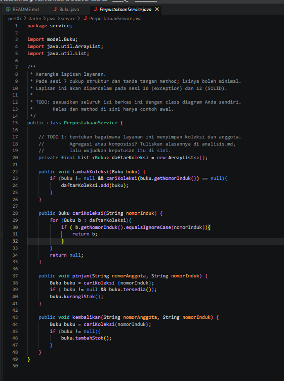

TODO 1: Menambahkan atribut daftarKoleksi bertipe List<Buku> untuk menyimpan daftar buku menggunakan ArrayList.

TODO 2: Menambahkan pengecekan agar buku tidak bernilai null dan tidak memiliki nomor induk yang sudah terdaftar sebelum dimasukkan ke koleksi.

TODO 3: Membuat perulangan untuk mencari buku berdasarkan nomor induk menggunakan equalsIgnoreCase(), sehingga pencarian tidak membedakan huruf besar dan kecil.

TODO 4: Menambahkan pencarian buku dan pengecekan ketersediaan sebelum mengurangi stok buku yang dipinjam.

TODO 5: Menambahkan pencarian buku dan memanggil tambahStok() untuk menambah stok saat buku dikembalikan.

d. Main.java

Screenshot = 

- Before :
  
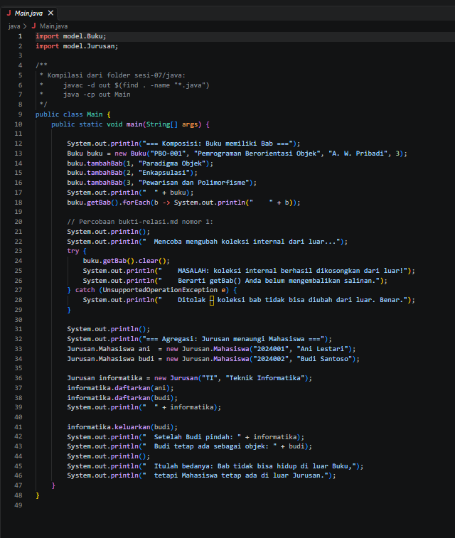

Program digunakan untuk menguji hubungan komposisi antara Buku dan Bab.

Program digunakan untuk menguji hubungan agregasi antara Jurusan dan Mahasiswa.

Program menampilkan hasil pembuatan buku, daftar bab, serta mahasiswa yang terdaftar dan yang dikeluarkan dari jurusan.

- After :
  
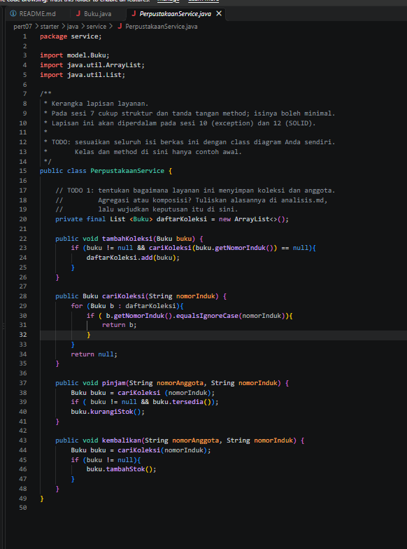

Program menguji apakah daftar bab dari getBab() tidak bisa diubah dari luar. Jika perubahan ditolak dengan UnsupportedOperationException, berarti koleksi yang dikembalikan tidak bisa dimodifikasi.

Program menguji agregasi dengan mengeluarkan Budi dari jurusan, tetapi objek Budi tetap ada.

Program menunjukkan bahwa Bab merupakan bagian dari Buku, sedangkan Mahasiswa tetap bisa ada meskipun sudah dikeluarkan dari Jurusan.

## PHP
a. main.php

Bukti Screenshot =

- Before :
  
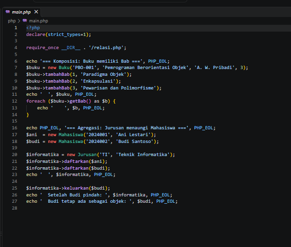

Program membuat objek Buku dan menambahkan tiga bab.

Program membuat objek Mahasiswa bernama Ani dan Budi.

Program mendaftarkan Ani dan Budi ke dalam Jurusan.

Program belum menguji apakah daftar bab tidak bisa diubah dari luar.

- After :
  
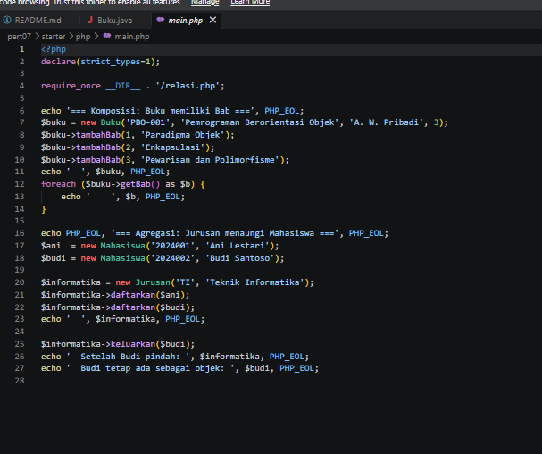

Program tetap membuat buku dan menambahkan tiga bab.

Program menampilkan daftar mahasiswa setelah Budi dikeluarkan dari jurusan.

Program menampilkan objek Budi untuk membuktikan bahwa Budi tetap ada meskipun sudah dikeluarkan dari Jurusan.

b. relasi.php

Bukti Screenshot = 

- Before :
  
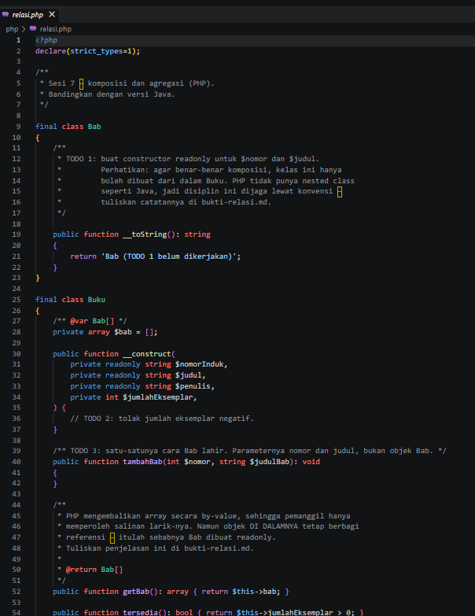
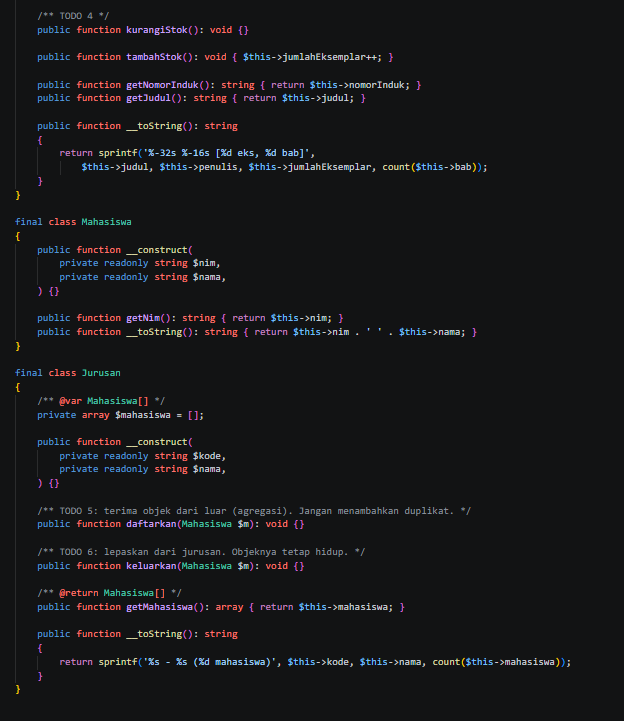

TODO 1: Constructor pada class Bab belum dibuat untuk menyimpan nomor dan judul bab.

TODO 2: Validasi jumlah eksemplar pada class Buku belum dibuat untuk menolak nilai negatif.

TODO 3: Method tambahBab() belum diisi untuk membuat objek Bab baru.

TODO 4: Method kurangiStok() belum diisi untuk memeriksa ketersediaan dan mengurangi stok buku.

TODO 5: Method daftarkan() pada class Jurusan belum diisi untuk mendaftarkan mahasiswa tanpa duplikat.

TODO 6: Method keluarkan() belum diisi untuk mengeluarkan mahasiswa dari jurusan.

- After :
  
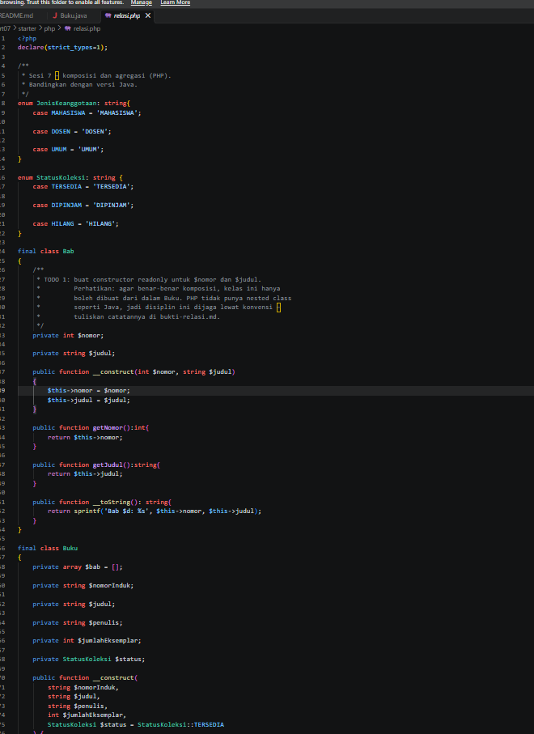
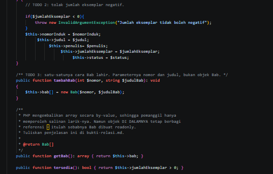
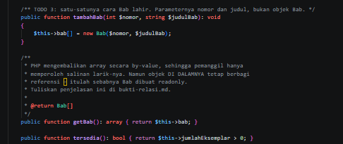
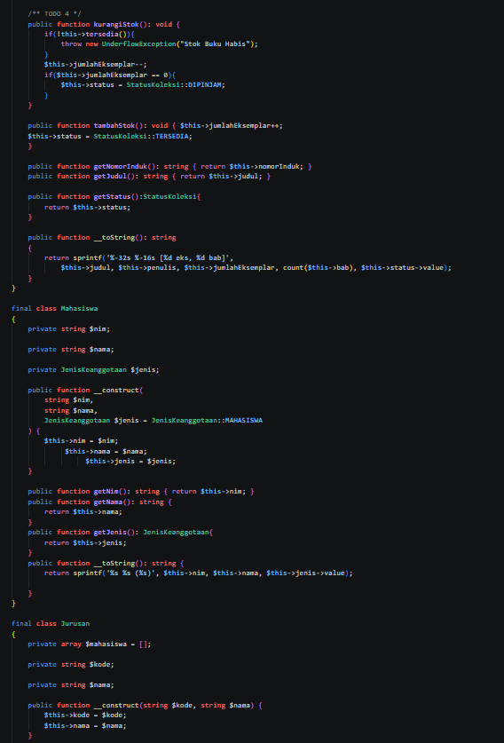
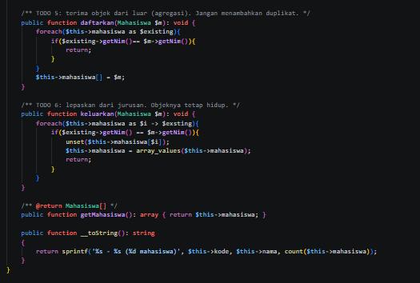

TODO 1: Menambahkan constructor pada class Bab untuk menyimpan nomor dan judul, serta getter untuk mengambil datanya.

TODO 2: Menambahkan validasi agar jumlah eksemplar tidak boleh negatif menggunakan InvalidArgumentException.

TODO 3: Mengisi method tambahBab() dengan membuat objek Bab baru dan menyimpannya ke dalam array $bab.

TODO 4: Mengisi method kurangiStok() untuk memeriksa ketersediaan buku, mengurangi stok, dan mengubah status menjadi DIPINJAM jika stok habis.

TODO 5: Mengisi method daftarkan() untuk memeriksa NIM mahasiswa agar tidak terjadi duplikasi sebelum menambahkannya ke array.

TODO 6: Mengisi method keluarkan() untuk mencari mahasiswa berdasarkan NIM, menghapusnya dari array, dan merapikan indeks array.

